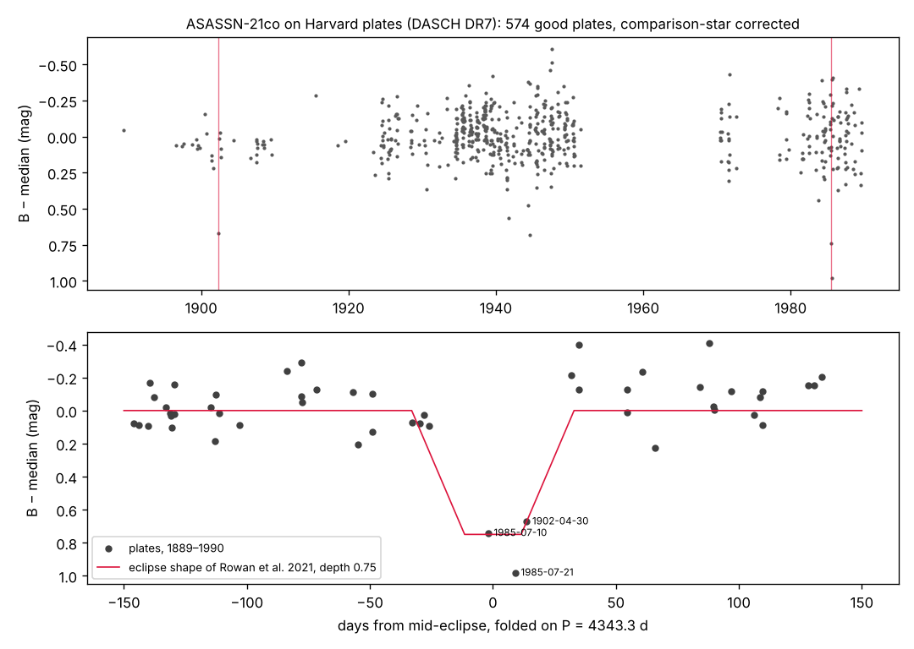

# plate-eclipses

**Finding the past eclipses of rare eclipsing stars on a century of Harvard photographic plates.**

Some stars dim only once every few years: binaries with long orbits, and stars passing behind dust. Modern sky
surveys cover about ten years, so for many such stars only one or two events have been seen and the period is
unknown. Harvard's glass plates cover about 1890 to 1990. DASCH scanned them and made them public in a final
release in December 2024. This project uses the plates to find earlier events, measure periods over a century, and
predict the next event, which anyone can then check.

Part of Foundation0's astronomy work ([astr0](https://github.com/Foundation-0/astr0)). It began as the first pilot
of the [deep-fields scouting](https://github.com/Foundation-0/f0/tree/claude/sleepy-pasteur-k5knht/deep-fields) of 18 Oct 2026.

**Status: claimed, not peer reviewed.** The checks it has passed: comparison stars on every plate, an independent
re-measurement of the key plates from the plate images, a period scan against 40 null runs, and a period from the
plates alone that predicts the two modern eclipses. No person outside the project has checked it yet.

| Result | Status |
|---|---|
| ASASSN-21co: eclipses on Harvard plates in 1902 and 1985; P = 4,343.3 ± 1.1 d; next primary eclipse centred on **3 Feb 2033 ± 3.5 d** | Claimed. Checked by the four tests above; not reviewed by a person |
| ASASSN-24fw: the published 1937 and 1981 dimmings recovered blind | Reproduces a published result (method check) |
| The other 29 stars of the ASAS-SN "big dippers" list | No credible historical events; the plates are too sparse or the events too shallow (see below) |

## The question

ASAS-SN's systematic search for "big dippers" ([JoHantgen et al., arXiv:2507.19594](https://arxiv.org/abs/2507.19594))
lists 31 stars with rare, long dimmings:

- 13 binaries seen to eclipse only once;
- 7 seen to eclipse more than once;
- 11 dipper stars.

For most of them the period is unknown, because modern surveys cover only about ten years.

Harvard's glass plates cover about 1890 to 1990. They were scanned by DASCH, whose final data release
([DR7](https://dasch.cfa.harvard.edu/dr7/)) came out in December 2024, after which the project ended. Anyone can fetch
a light curve through its public API. Almost no one has systematically compared the plates with modern surveys.
Do earlier eclipses of these stars show up on the plates?

## Method

All code is in [`src/`](src/); the outputs are in [`results/`](results/). The per-plate evidence for ASASSN-21co is in [`results/asassn21co_plates.csv`](results/asassn21co_plates.csv).

1. **Fetch** ([`src/fetch.py`](src/fetch.py)). Match each star to DASCH's APASS catalogue, and pick up to 12
   comparison stars of similar brightness, mostly within about 7 arcminutes (up to about 14 where few qualify).
   Download all the light curves (about 360, 200 MB).
2. **Correct each plate** ([`src/core.py`](src/core.py)).
   - Shift the star's magnitude by the median offset of the comparison stars on the same plate.
   - Drop detections that fail DASCH's standard quality flags, or are flagged as defects or rejected blends.
   - Count a non-detection only when both hold: the plate reached at least 0.5 mag fainter than the star's normal
     brightness, and at least 40% of the comparison stars were detected on it.
3. **Blind event search** ([`src/events.py`](src/events.py)). Look for runs of faint plates or non-detections spanning
   at least three nights, with no normal plate in between.
4. **Null test** ([`src/nulltest.py`](src/nulltest.py)). Run the same search on all 319 comparison stars, which
   should be constant.
5. **Period scan** ([`src/period.py`](src/period.py)).
   - For each trial period, predict where the earlier eclipses fall, counting back from the modern one.
   - Score the plates that land inside those predicted eclipses: eclipse versus no eclipse.
   - Repeat 40 times with the modern eclipse moved off its true time, to measure how high a peak noise alone can reach.
6. **Independent re-measurement** ([`src/cutouts.py`](src/cutouts.py), [`src/remeasure.py`](src/remeasure.py)).
   - Download the plate images around the star.
   - Measure the plate density within a 20″ aperture, calibrated against about 20 APASS stars on the same image.
     This shares nothing with the DASCH photometry pipeline except the plate scan.

## Check on a known case: ASASSN-24fw

Two papers in 2025 found historical dimmings of ASASSN-24fw on DASCH plates, in 1937 and 1981
([arXiv:2507.03080](https://arxiv.org/abs/2507.03080), [arXiv:2507.05367](https://arxiv.org/abs/2507.05367)).
The blind search recovers both without being told where to look:

| Event | Plates | Nights | Plate series |
|---|---|---|---|
| 1937.12 to 1937.20 | 10 | 8 | 5 |
| 1981.02 to 1981.25 | 8 | 8 | 2 |

The first version of the pipeline missed both events. It demanded that 75% of the comparison stars be detected, and
it used a stricter quality mask. Comparison stars as faint as the target are often near the plate limit, so the bar
was too high. Running the search against a known answer is what caught this.

## Result: ASASSN-21co

**What was known.** ASASSN-21co is a pair of M giants in a 12-year orbit
([Rowan et al. 2021, RNAAS 5, 147](https://arxiv.org/abs/2107.00662)):

- primary eclipse 0.6 mag deep in V and g, lasting about 66 days in total, of which about 23 days are total;
- period 4,344 d, from an eclipse seen by ASAS around 23 April 2009 and one seen by ASAS-SN in March 2021;
- no uncertainty is given;
- that paper does not use photographic plates.

**What the plates show** (full numbers in [`results/asassn21co.json`](results/asassn21co.json)):

1. **An eclipse in mid-1985.**
   - Plates dsb1716 (10 July 1985) and dsb1725 (21 July 1985) are 0.74 and 0.98 mag faint. On the same plates,
     12 of 12 and 10 of 12 comparison stars were detected.
   - Three more plates from the same weeks are also faint (+1.10, +0.61, +0.44 mag), but carry quality flags, so they
     are not used.
   - The plates of 16 June and 13 August 1985 are normal.
   - Re-measured from the plate images: +0.77 and +0.91 mag on the eclipse plates, against +0.23 and +0.15 on the
     normal plates either side ([`results/remeasure.txt`](results/remeasure.txt)).
2. **An eclipse in 1902.**
   - One plate, b29521 (30 April 1902), is 0.67 mag faint; 11 of 12 comparison stars were detected.
   - Re-measured from the image: +0.70, against +0.06 to +0.20 on plates from August 1901, June 1902 and September 1902.
   - Plate b29976, 41 days later, is normal.
   - This eclipse rests on a single plate.
3. **The period from the plates alone.** The two historical eclipses are 7 orbits apart, giving
   P = **4,342.0 ± 2.7 d**. That period predicts the two modern eclipses, which were not used to derive it:

   | Eclipse | Predicted from plates | Observed |
   |---|---|---|
   | 2009 (ASAS) | 21 Apr 2009 ± 6 d | around 23 Apr 2009 |
   | 2021 (ASAS-SN) | 11 Mar 2021 ± 8 d | began 10–12 Feb 2021, so mid-eclipse about 16 Mar |

4. **A blind period scan finds it.** The scan covers 3,000 to 45,000 days and is anchored only on the 2021 eclipse.
   - Its strongest peak is **4,343.5 d** (ΔlogL 18.0 over three nights).
   - None of the 40 null runs reaches that height; their best is 15.4.
   - The second peak, 3,255 d, is a 3/4 alias; it does not match the 2009 eclipse.
   - Output: [`results/period_scan_asassn21co.txt`](results/period_scan_asassn21co.txt).
5. **Ephemeris from all four eclipses, 1902 to 2021.**
   - **P = 4,343.3 ± 1.1 d**; χ² = 0.33 for 2 degrees of freedom.
   - The timing uncertainties of the 2009 and 2021 eclipses (5 and 3 days) are assumptions, because the sources give
     only dates.
6. **Prediction: the next primary eclipse is centred on 3 February 2033 ± 3.5 d.** First contact is about
   1 January 2033 and last contact about 8 March 2033. Anyone with a small telescope in the southern hemisphere can
   test this.



Plate images, with the star circled, for the 1985 eclipse ([`results/asassn21co_plates_1985.png`](results/asassn21co_plates_1985.png))
and the 1902 eclipse ([`results/asassn21co_plates_1902.png`](results/asassn21co_plates_1902.png)).

**What this adds.**
- Two eclipses, from 1902 and 1985, that we found no earlier report of.
- A period measured over ten orbits and 120 years, with an uncertainty attached.
- A dated prediction for the next primary eclipse in 2033.

**What it does not add.** It does not change the period much: 4,343.3 ± 1.1 d against the published 4,344 d.

**Open points.**
- The eclipse looks deeper on the blue-sensitive plates (0.6 to 0.9 mag) than in V and g (0.6 mag). This is
  plausible for two giants of slightly different temperature, but photographic magnitudes carry colour terms, so we
  do not interpret it.
- The 1902 eclipse rests on one plate.

## The other 30 stars: what the plates can and cannot say

- **Too shallow.** For 10 stars the modern event is shallower than 2.5 times the plate-to-plate scatter (typically
  0.10 to 0.20 mag). The plates cannot see events that shallow.
- **ASASSN-20nq (J005437+644347).** Period 752.3 d, but the eclipses are short (about 11 d). Only two plates fall
  inside predicted eclipses, both 0.27 mag faint. Inconclusive.
- **ASASSN-23ik (J223332+565552).** The first version of the pipeline proposed a candidate period of 1,917.8 d. It
  fails: plates in the predicted 1939 eclipse are normal.
- **No other credible historical events.** The remaining blind events
  ([`results/events.txt`](results/events.txt)) are at the level the null test produces from constant stars:
  - 35 of 319 comparison stars show at least one event, most of them clusters of 3 to 5 plates
    ([`results/nulltest.txt`](results/nulltest.txt)).
  - J073924-272916 is rarely detected at all (40 good plates from about 1,600 plate rows), which points to a blend.
  - ASASSN-21js (J114712-621037) shows events only on low-resolution plates in a crowded part of the Milky Way.
  - Neither would pass without inspecting the plate images, and we did not inspect them.
- **The plates are sparse for these stars.** [`results/coverage.txt`](results/coverage.txt) gives, for each star, the
  share of 1890 to 1990 in which a repeat of its modern event would have landed on at least one good plate. For
  stars of B ≈ 14 to 15 this share is low, because good plates cluster in certain years and DASCH has a known gap
  from 1953 to 1968:
  - ASASSN-21qj, the star thought to be dimmed by debris from a planetary collision, has a 2-mag, 608-day event; a
    repeat would have been caught in about 50% of the century.
  - J073234-200049 has a 1.4-mag eclipse; a repeat would have been caught only 7 to 14% of the time.

  So "no event seen" says little about these stars, and we do not claim that it does.

## Lessons for scaling up

- **The strong tool is the targeted test.** When a modern eclipse predicts where the earlier ones must fall, a couple
  of plates are decisive. A blind search needs many plates over many nights to beat the false-alarm rate measured on
  constant stars.
- **Pick bright stars with long events.** The method works for stars of B ≲ 13.5 with events lasting weeks or longer.
  ASASSN-21co (B ≈ 13.3, 66-day eclipse) has 574 good plates; stars of B ≈ 15 have about 100.
- **Next targets.** Every long-period eclipsing binary or dipper brighter than about B = 13.5 that has one or two
  modern eclipses and an uncertain period. Candidate sources: VSX, the ASAS-SN variable-star catalogue, and Gaia DR3
  and DR4 eclipsing binaries.
- **Always validate on a known case and run the null test.** Without them, this pilot would have reported the
  pipeline's false events, and missed the true ones.

## Roadmap

1. **A person checks ASASSN-21co.** Look at the plate images and the evidence table, then sign.
   - Write a short note to the Research Notes of the AAS, offered to the ASAS-SN authors as co-authors.
   - Send the 2033 prediction to the AAVSO.
2. **Scale up.** Run the targeted test on every long-period eclipsing binary or dipper brighter than about
   B = 13.5 that has one or two modern events and an uncertain period. Candidate sources:
   - VSX entries of type EA with a long or unknown period;
   - the ASAS-SN variable-star catalogue;
   - Gaia DR3 eclipsing binaries, and DR4 from 2 Dec 2026.
   - First expanded ranked list (TARGETS-V2, 18 Oct 2026): [`results/targets_v2.md`](results/targets_v2.md),
     generated by [`src/targets_v2.py`](src/targets_v2.py) from live VSX, ASAS-SN and Gaia DR3
     catalogue queries, scored by a DASCH-coverage proxy (see its validation note). No eclipse is
     claimed for any listed target yet.
   - Gaia DR4 day-one TESS cross-check plan: [`GAIA-DR4-READINESS.md`](GAIA-DR4-READINESS.md).
3. **Before scaling, make the checks automatic.**
   - Fetch cutouts and re-measure them for every candidate eclipse plate.
   - Run the null test on each target's own comparison stars.
   - Record which modern epochs come from published timings and which are assumed.
4. **For bulk data,** ask DASCH for a higher API rate limit (see their
   [bulk formats page](https://dasch.cfa.harvard.edu/dr7/bulk-formats/)).

## Reproduce

Requires Python 3 with `numpy`, `astropy` and `matplotlib`, and network access to `api.starglass.cfa.harvard.edu`.
Set `DASCH_PILOT_DATA` to keep the downloads (about 200 MB) somewhere other than `./data`.

```
cd src
python fetch.py                  # about 15 min; writes ../data/ (git-ignored)
python events.py                 # blind historical events, all 31 stars
python nulltest.py               # the same search on the comparison stars
python coverage.py               # how much of the century each star's event could have been caught in
python period.py J181752-580749 2459289.5 66 0.7 3000 40      # blind period scan + 40 null runs
python asassn21co.py             # eclipse times, ephemeris, figure
python export_plates.py          # per-plate evidence table
```

`cutouts.py` and `remeasure.py` fetch and re-measure plate images. Their command lines are recorded at the top of
[`results/remeasure.txt`](results/remeasure.txt). `fetch.py` reproduces the targets and comparison stars used here
exactly (checked on 18 Oct 2026).

## Credit and acknowledgements

- **Who did what.**
  - The pilot was designed, run and written up by Claude (Anthropic), an AI model, in a Claude Code session for
    Foundation0 on 18 Oct 2026.
  - A Foundation0 member chose the direction (look where nobody has looked) and the home for the work.
  - No person has yet checked the result.
- **Targets.** From JoHantgen et al., "A systematic search for big dippers in ASAS-SN"
  ([arXiv:2507.19594](https://arxiv.org/abs/2507.19594)).
- **ASASSN-21co.** The eclipse shape and the published period are from Rowan et al. 2021, RNAAS 5, 147
  ([arXiv:2107.00662](https://arxiv.org/abs/2107.00662)). The 2021 eclipse start is from AAVSO Alert Notice 732.
- **DASCH acknowledgement**, as requested by [DASCH](https://dasch.cfa.harvard.edu/citing/): This work has made use
  of data provided by Digital Access to a Sky Century @ Harvard (DASCH), which has been partially supported by NSF
  grants AST-0407380, AST-0909073, and AST-1313370. Work on DASCH Data Release 7 received support from the
  Smithsonian American Women's History Initiative Pool.
  - Grindlay et al. 2012, IAU Symp. 285, 29 (doi:10.1017/S1743921312000166).
  - Laycock et al. 2010, AJ 140, 1062 (doi:10.1088/0004-6256/140/4/1062).
  - Tang et al. 2013, PASP 125, 857 (doi:10.1086/671760).
  - Photometric calibration uses APASS.
- **Data.** Raw DASCH light curves and plate cutouts are not redistributed here (DASCH states no data licence). They
  are re-fetched by the scripts. The derived measurements in `results/` are this project's own.

## Licence

Code: Apache License 2.0 (see [LICENSE](LICENSE)), as for Foundation0's other code.
